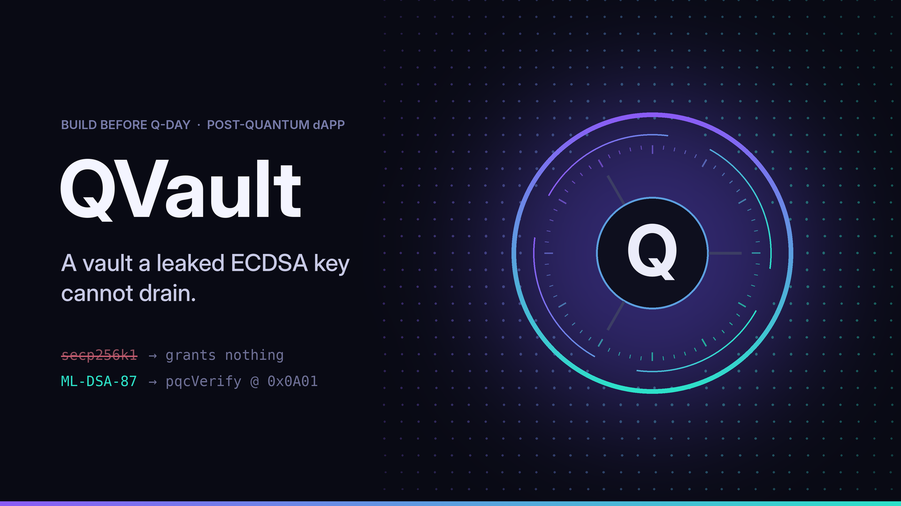

# QVault



**A vault that a leaked ECDSA key cannot drain.**

Built for [Build Before Q-Day](https://build.qorechain.io) — category **Post-Quantum dApp**, entered in the **Q-Day Drill**.

On Q-Day, every secp256k1 key on every chain becomes public. QoreChain already protects its Cosmos lane with mandatory hybrid (secp256k1 + ML-DSA-87) signatures, but an EVM transaction is still signed with secp256k1 alone: whoever holds the classical key can spend inside any open EVM window, and any contract that authorises by `msg.sender` belongs to them. QVault removes that path. Every operation that moves value or changes authority needs an **ML-DSA-87 signature by the key the chain itself holds for the owner**, verified on chain through the `pqcVerify` precompile. The classical key grants nothing.

## Threat model

| Attacker has | Can do against QVault |
|---|---|
| Owner's secp256k1 key (the Q-Day / drill scenario) | Send EVM txs as the owner **inside an open window** → no effect: no function trusts `msg.sender`. Burn at most the window's fee budget. |
| Their own valid ML-DSA-87 key | Nothing: signatures are checked against `pqcKeyStatus(owner)`, not a caller-supplied key. |
| Owner's **public** ML-DSA key registered on their own account | Nothing: QVault requires `possessionProven`, so a copied public key does not pass. |
| A valid owner signature seen in the mempool | Front-run the relay → same effect as the owner's intent: recipient, amount, token, nonce, deadline, chain id and vault address are all inside the signed digest. |
| Guardian's ML-DSA-87 key | Freeze withdrawals. Nothing else (cannot withdraw, unfreeze or change authority). |
| Owner's ML-DSA-87 key | Everything — the root of trust is the PQ key. Mitigation path: guardian freeze + timelocked large withdrawals (roadmap). |

Fail-closed: if the PQC precompiles are inactive (as on mainnet today), calls return empty data and every operation reverts.

## Design

```
            ML-DSA-87 sig over digest                    pqcKeyStatus(owner)  0x0A02
 owner ───────────────────────────────► any relayer ──► QVault ──────────────────────► chain PQC registry
 (PQ key off-chain)                     (any account)    │      pqcVerify(pub,sig,d) 0x0A01
                                                         └────────────────────────────► precompile
```

- `digest = keccak256(abi.encode("QVault.v1" domain, chainid, vault, op, nonce, deadline, payload))`, signed as its 32 raw bytes.
- Ops: `withdraw` (native QOR or ERC-20), `setOwner`, `setGuardian`, `freeze`, `unfreeze` — owner; `guardianFreeze` — guardian.
- Separate owner / guardian nonces: a guardian freeze never invalidates a pending owner signature.
- `setOwner` / `setGuardian` refuse accounts without a registered, possession-proven ML-DSA-87 key, so the vault cannot be bricked by a typo.
- Rotating the owner's key on chain (`MsgRotatePQCKey`) rotates it for the vault automatically — the vault never stores a key.

Gas: one `pqcVerify` is ~85k inside the precompile; a withdrawal tx is ~0.3M gas, dominated by the 4,627-byte signature in calldata.

## Q-Day Drill configuration

1. Fresh drill account (never held mainnet funds), ML-DSA-87 key registered **with proof of possession** (`possession_proven = true`).
2. Funds live in the vault; the drill account itself holds only fees.
3. The EVM window used during the drill is opened with `--allowed-targets <QVault>` and a `max-value` equal to a small fee budget. That bounds the only loss the attacker can cause (fees).
4. The required "normal transaction" during the drill is a PQ-signed withdrawal relayed through that window.

## Run

```sh
forge install foundry-rs/forge-std
forge test -vv         # 19 tests: leaked-ECDSA, replay, binding, guardian, fail-closed, fuzz
```

Testnet runbook (`qorechain-diana`, EVM chain id 9800):

```sh
cd client && npm install
npm run drill new                       # fresh eth-native account -> secrets/drill.mnemonic (gitignored)
# fund the printed qor1 address from https://dashboard.qorechain.io/faucet
npm run drill register                  # ML-DSA-87 key WITH proof of possession
npm run drill status                    # must say: possession proven: true

FUND_UQOR=5000000 npm run drill open-deploy   # unscoped window (deploy needs it) + 5 QOR budget to fund
# deploy with ethers (client/deploy.ts): forge script simulates without the 0x0A02 precompile, and
# forge create misreads QoreChain receipts (missing field feePayer) and reports a successful deploy as failed.
forge build && cd client && npm run deploy && cd ..
cast send <vault> --value 5ether --rpc-url qore_testnet --private-key 0x$(cd client && npm run -s drill key 2>/dev/null)
cd client && npm run drill close        # no window left open: the ECDSA key alone can do nothing

# during the drill: the one "normal transaction"
npm run drill open-drill <vault>        # target = vault only, budget = fees of 2 txs
npm run withdraw -- <vault> <to> 1000000000000000000
npm run drill close
```

## v2 — timelock + guardian veto (`QVaultV2.sol`)

v1 makes a leaked **ECDSA** key worthless. v2 also bounds a leaked **owner ML-DSA-87** key.

- **Instant withdrawals** only within a per-token budget per 24 h (native QOR budget set at deploy; a token without a budget is queue-only).
- **Everything else is timelocked** (`queue` → wait `delay` → anyone calls `execute`): larger withdrawals, owner / guardian / delay / budget changes, unfreeze. Stale after a 14-day grace period.
- **Guardian** — a separate account with its own ML-DSA-87 key — can `guardianFreeze` and `cancel` any queued operation. It can never move funds or change authority.
- **Only the guardian cancels** while one is set; otherwise a thief holding the owner key could cancel the owner's own rescue withdrawal.

**Bound:** with an honest guardian, a thief holding the owner's PQ key gets at most one period's instant budget (`test_maxLossWithHonestGuardian_isOnePeriodBudget`).

**Trade-off, stated plainly:** a malicious guardian can veto forever (it cannot steal). A guardian that is merely gone cannot block anything: unfreeze and its own removal go through the timelock and execute after `delay`.

### Guardian agent (`client/guardian.ts`)

Polls the vault every few seconds. Deny-by-default, because an owner signature alone proves nothing once the owner key may be stolen:

- queued operation not approved in the local policy file → **cancel**;
- queued withdrawal to an allowed recipient → pass;
- instant withdrawal to an unknown recipient → **freeze**.

The owner approves an exact operation out of band: `npm run v2 -- approval <op>` prints a hash for `guardian-policy.json`, which a thief with the owner key cannot write. The agent opens its own vault-only EVM window when it has to act. Decision logic is a pure function with unit tests (`guardian-policy.test.ts`).

### Testnet run, 14 Nov 2026

Vault `0x032d58891efDdBa939bC349Ebb32B8A37191DE0f`, delay 300 s, instant budget 2 QOR/24 h, funded with 20 QOR. The "thief" signs with the real owner key.

| Step | Action | Guardian | Result |
|---|---|---|---|
| A | instant 1 QOR → owner | pass | paid |
| B | thief queues 15 QOR → `0x…dEaD` | **CANCEL** (`0x22b3b395…`) | 7 s after queueing, incl. opening its window |
| C | thief queues `setGuardian(0)` | **CANCEL** (`0x7a5bc9a5…`) | guardian stays |
| D | owner queues 5 QOR → owner | pass | executed after 5 min |
| E | thief instant 0.5 QOR → `0x…dEaD` | **FREEZE** (`0x292723ca…`) | the only loss: within budget |
| F | owner queues unfreeze, pre-approved | pass | executed after 5 min |

Final state: 13.5 QOR (20 − 1 − 5 − 0.5), not frozen, guardian unchanged. Log: `guardian-log/2026-11-14.jsonl`.

## Status

- [x] Contract + tests against precompile mocks (real ABI from qorechain-core `docs/EVM_PRECOMPILES.md`)
- [x] Withdraw client (`client/withdraw.ts`) and drill-account tool (`client/drill.ts`: key registration with proof of possession, deploy window, vault-only drill window, close) — run against testnet
- [x] Testnet deployment: QVault `0x5a7f65d0573be384f64351f30a616ed48dca3015`, funded, first ML-DSA-87-authorised withdrawal `status 1`
- [x] Q-Day Drill registration (vault `0x5a7f…3015`); drill on 18 Nov — `client/watch.ts` records it to `drill-log/`
- [x] Guardian agent: cancels unapproved queued operations, freezes on instant withdrawals to unknown recipients — run on testnet
- [x] v2: instant budget + timelock, guardian veto — 21 Foundry tests, run on testnet
- [ ] Web UI

## Credits

- [`forge-std`](https://github.com/foundry-rs/forge-std) — Foundry test library (MIT/Apache-2.0)
- [`@qorechain/pqc`](https://www.npmjs.com/package/@qorechain/pqc) — ML-DSA-87 signing (Apache-2.0)
- [`@qorechain/sdk`](https://www.npmjs.com/package/@qorechain/sdk), [`@qorechain/evm`](https://www.npmjs.com/package/@qorechain/evm) — eth-native account, hybrid signing, EVM window (Apache-2.0)
- `client/drill.ts` follows the window helper of [build-before-qday](https://github.com/qorechain/build-before-qday) workshop 1 (`scripts/window.ts`)
- [`@cosmjs/stargate`](https://github.com/cosmos/cosmjs) — native-lane transport (Apache-2.0)
- [`ethers`](https://github.com/ethers-io/ethers.js) — EVM client (MIT)
- `IQorePQC` interface follows [qorechain-core](https://github.com/qorechain/qorechain-core) `contracts/interfaces/IQorePQC.sol` (Apache-2.0)

Built with AI coding assistants; see `AI_USAGE.md` (to be added).

## License

Apache-2.0
